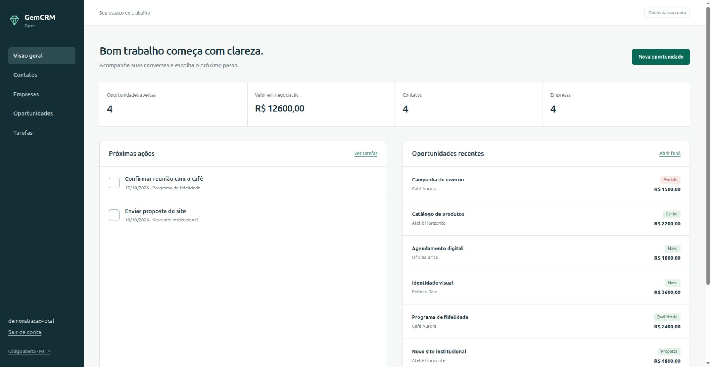

# GemCRM Open

A small, self-hosted CRM in Portuguese for contacts, companies, sales opportunities
and follow-up tasks. New code, independent of any private GemCRM application.

**MIT licensed.** Anyone can download, modify and redistribute it. This is an
early version for local use and evaluation; review deployment security before
putting it on the internet.



The screenshot uses fictional records from `seed_demo`, not customer data.

## What works

- Account creation, login and logout.
- Companies and contacts, with search and CSV export.
- Contact CSV upload, preview and explicit, all-or-nothing confirmation.
- A five-stage sales pipeline and opportunity values.
- Follow-up tasks with open, overdue, today, upcoming and completed filters, plus a dashboard with open opportunities and due actions.
- Per-account record isolation, CSRF protection and spreadsheet-safe CSV cells.
- Responsive, keyboard-accessible server-rendered pages; no external frontend CDN.

## Filter tasks by date

Open **Tarefas** and choose the deadline filter, or request it directly:

```text
/tasks/?status=today
/tasks/?status=upcoming
/tasks/?status=today&q=retorno
```

- `status=today` lists only open tasks of your account with `due_date` equal to Django's `timezone.localdate()`.
- `status=upcoming` lists only open tasks of your account with `due_date` strictly after `timezone.localdate()`.
- `q` search combines with every status filter. Existing `open`, `overdue` and `completed` filters keep working; an unknown status falls back to `all`.
- Dates use the configured Django `TIME_ZONE`, not the browser clock. Filters only read records and never change them.

## Paginate contacts

Open **Contatos** to browse only your account's contacts ordered by name then pk.

```text
/contacts/?q=marina
/contacts/?q=marina&page=2
/contacts/export/?q=marina
```

- Lists exactly 50 contacts per page. `q` filters by name, e-mail, phone or company after `q.strip()[:200]`.
- `page` uses Django `Paginator.get_page(request.GET.get("page"))`: missing, empty or non-integer shows the first page; zero, negative or beyond the last shows the last page. An empty result is page 1 of 1 with 0 records.
- Multi-page results show `Página X de Y` in `nav[aria-label="Paginação de contatos"]` with `rel="prev"`/`rel="next"` links only when available. Page URLs keep only `page` and the normalized `q` when non-empty.
- CSV export ignores `page` and exports all filtered contacts of your account.

## Relatório de pipeline por previsão

HTML em `/reports/pipeline/` e CSV em `/reports/pipeline/export/`.

- Query fechada com `start` e `end` em `AAAA-MM-DD`; ausência ou vazio sem filtro.
- Sem filtros inclui `expected_close` nulo; com qualquer data só conta previsão dentro do intervalo inclusivo.
- Mostra etapa e valor atuais por previsão; não é histórico, receita realizada, conversão ou garantia futura.
- HTML usa `R$ 1234,50` e CSV usa `1234.50`, ambos com duas casas e sem separador de milhar.
- Filtros inválidos retornam 400 sem tabela nem CSV.

## Run locally

Requires Python 3.12 or newer and [uv](https://docs.astral.sh/uv/).

```sh
git clone https://github.com/martinlofranodeoliveira/gemcrm-open.git
cd gemcrm-open
uv sync
uv run python manage.py migrate
uv run python manage.py runserver 127.0.0.1:8093
```

Open `http://127.0.0.1:8093/accounts/signup/` and create your own account. There
are no default credentials. SQLite data and a generated development secret stay
in the ignored `.data/` directory. Never upload this directory.

Without uv, create and activate a Python virtual environment, install
`requirements.txt`, then use `python manage.py ...` for the same commands.

To populate an **empty test account** with fictional examples:

```sh
uv run python manage.py seed_demo --username YOUR_TEST_USERNAME
```

## Checks

```sh
uv run python manage.py check
uv run python manage.py makemigrations --check --dry-run
uv run python manage.py test
```

Tests cover authentication, record ownership, foreign-key isolation, CSRF,
stage changes, CSV injection, escaping, import validation, replay protection,
transaction rollback and related-record preservation.

## Import contacts from CSV

Open **Contatos → Importar CSV**, select a UTF-8 file and review the preview.
Uploading never creates contacts. Correct every listed error or duplicate, then
choose **Importar contatos** to save the complete batch. Sending another file
replaces the previous preview, even when the replacement is invalid.

```csv
name,email,phone,company,notes
Example contact,example@example.com,,,Fictional example
```

- `name` is required; `email`, `phone`, `company` and `notes` are optional.
  A UTF-8 BOM is accepted. Use commas as separators and quote values containing
  commas. Each accepted file is limited to 256 KiB and 500 contacts.
- Companies must already exist under one unambiguous, exact name in your account.
  The importer never creates companies or looks up another account's records.
- Emails repeated in the file or your existing contacts block the entire batch.
  Matching uses the policy described below. Blank emails are allowed. This does
  not merge or update records, or impose global email uniqueness on manual edits.
- Confirmation is valid for 15 minutes and rechecks current database records.
  The batch and a durable replay receipt are saved in one transaction. A second
  confirmation cannot import the same preview, including after an overlapping
  login response restores an old session. A separate canonical preview state
  also rejects old previews after another upload, including invalid replacements.
  If an overlapping session save loses the latest CSV, the importer fails closed
  and asks you to upload it again. A failed transaction saves no contacts
  or receipt, allowing a retry while the preview remains valid. SQLite write
  contention can require a retry; imports serialize per account on databases
  supporting row locks.
- The current checks support up to 20,000 existing contacts and matching company
  records per account. Larger or inconsistent data sets fail closed for review.

The workflow requires Django's database session backend. The uploaded CSV stays
in the server-side session, never a signed-cookie session or hidden form field.
The 15-minute confirmation window is **not** an automatic data deletion timer:
drafts follow the session's retention unless replaced, consumed or logged out.
Treat session storage and database backups as private contact data.

After updating an existing installation, apply migrations before serving traffic:

```sh
uv run python manage.py migrate
```

For maintenance, remove expired sessions and replay receipts with:

```sh
uv run python manage.py clearsessions
uv run python manage.py purge_contact_import_receipts
```

The cleanup removes only expired receipts and preview states; it does not touch
contacts or active previews. These records contain hashed nonce/session
identifiers, timestamps, state and the owner, not uploaded CSV. Configure an
appropriate maintenance schedule for your install.
The accepted file limit does not replace a reverse-proxy HTTP request-body limit.
See the [workflow design notes](docs/design/contact-import.md) for interface states,
accessibility behavior and validation scope.

## Preview imported contacts in Python

Two pure helpers support callers building an import workflow. `parse_contacts`
validates CSV text without writing records. `detect_duplicate_emails` flags
emails already supplied by the caller or repeated in the accepted preview:

```python
from crm.contact_import import parse_contacts
from crm.contact_duplicates import detect_duplicate_emails

preview = parse_contacts("name,email\nExample,example@example.com\n")
if preview["valid"]:
    # Supply only email addresses belonging to the current account.
    existing_emails = ["example@example.com"]  # fictional example
    duplicates = detect_duplicate_emails(preview["rows"], existing_emails)
    print(duplicates)
    # [{"line": 2, "email": "example@example.com",
    #   "existing": True, "previous_line": None}]
```

Duplicate matching trims surrounding whitespace and applies `casefold()` to
emails. Blank emails are ignored; dots, plus suffixes and provider-specific
aliases are preserved. This is an explicit CRM matching policy, not a test of
mail delivery or proof that two addresses belong to one person. Each conflict
contains exactly `line`, normalized `email`, `existing`, and `previous_line`;
the last field references the first earlier matching import row, when present.
Results retain input order and do not modify either input.

The helper accepts lists, validates addresses and unique integer row lines
starting at 2, and raises `ValueError` for malformed inputs. Defaults are
`max_rows=500` and `max_existing=20000`, independently inclusive; larger lists
are rejected, including blank or repeated entries. Both limits must be positive
integers, excluding booleans.

These helpers query no database and do not verify ownership: the caller must
filter existing emails to the current account. They neither create, merge nor
update contacts themselves. The import screen composes them with owner-scoped
lookups and transactional checks when saving.

## Deployment and data

The development server is not a production server. Production requires a WSGI
server, HTTPS reverse proxy, static-file serving, backups, `DJANGO_DEBUG=false`,
a private `DJANGO_SECRET_KEY` and explicit `DJANGO_ALLOWED_HOSTS`. Configure
secure session/CSRF cookies for HTTPS. `.env.example` documents the environment
variables; it is not automatically loaded. Run `manage.py check --deploy` against
your deployment configuration and review its findings.

Each account sees its own records. Team sharing, password-reset email, audit
logs and integrations are future work, not current capabilities.

## Contribute

See [ROADMAP.md](ROADMAP.md), [CONTRIBUTING.md](CONTRIBUTING.md) and [AGENTS.md](AGENTS.md).
AI-assisted work must meet the same tests and privacy requirements. One complete,
useful change belongs in one commit; no empty or artificial activity.


<!-- community-core:pipeline-forecast-filter -->
### Pipeline forecast filter and totals core

Lets the Portuguese self-hosted CRM build the documented pipeline-by-forecast report from pure JSON without database or clock reads. It mirrors /reports/pipeline/ filtering: empty start/end keeps null forecasts, any bound keeps only inclusive in-range dates, invalid bounds are rejected for 400 handling, and per-stage plus grand totals are formatted as R$ 1234,50 for HTML and 1234.50 for CSV with no thousand separator. Ownership filtering stays with the caller.

Reusable deterministic JSON core: `crm/features/pipeline_forecast_filter.py`, API `run_feature(payload)`. This module is independently tested; application/UI integration is outside this change.

Exposes run_feature(payload) -> dict as a pure deterministic function with no I/O, env, time, randomness, callbacks or dependencies. Input payload must be an object with optional keys: deals (list, default []), start (str or None, default None), end (str or None, default None). Each deal must be an object with pk int (booleans rejected), title str, stage str one of new, qualified, proposal, won, lost, value str matching ^(0|[1-9][0-9]*)(\.[0-9]{1,2})?$ with total cents <=99999999999999, expected_close str or None; extra keys ignored. Missing/None/empty-string start/end means unbounded; otherwise must be YYYY-MM-DD valid calendar date else ValueError. If both bounded and start>end raise ValueError. Deals longer than 5000 raise ValueError. Titles must be str else ValueError. Expected_close None/missing/"" means null; otherwise must be YYYY-MM-DD valid calendar date else ValueError. Steps: 1) Normalize start/end to None when missing/None/"" else validated string. 2) Convert each value to integer cents ("100"->10000, "100.5"->10050, "100.05"->10005) without float. 3) Filter in input order: when both bounds None keep all including null; otherwise keep only non-null dates with (start is None or d>=start) and (end is None or d<=end) lexicographically equal to chronological for YYYY-MM-DD. 4) Build results list copying pk,title,stage, expected_close (None for null), value_cents int, value_csv "1234.50" exactly two decimals no thousand separator, value_display "R$ 1234,50" exactly two decimals comma decimal no thousand separator. 5) Aggregate by_stage in fixed order new,qualified,proposal,won,lost each as {count int, total_cents int, total_csv str, total_display str} with zero as "0.00"/"R$ 0,00", plus grand {count,total_cents,total_csv,total_display}. Returns dict with start, end (normalized None or string), total_count int, results list, by_stage object, grand object. Raises ValueError on malformed types or dates. Caller must pre-filter deals to current account and map ValueError to 400 with no table/CSV; function does no ownership check, DB query, CSV file handling, or clock read and never mutates inputs. Totals reflect current stage/value snapshot, not history, realized revenue, conversion, or future guarantee.

Examples (JSON input and expected output):

```json
{
  "input": {
    "deals": [
      {
        "expected_close": null,
        "pk": 1,
        "stage": "new",
        "title": "Padaria",
        "value": "100.00"
      },
      {
        "expected_close": "2026-03-10",
        "pk": 2,
        "stage": "won",
        "title": "Mercado",
        "value": "234.50"
      }
    ]
  },
  "output": {
    "by_stage": {
      "lost": {
        "count": 0,
        "total_cents": 0,
        "total_csv": "0.00",
        "total_display": "R$ 0,00"
      },
      "new": {
        "count": 1,
        "total_cents": 10000,
        "total_csv": "100.00",
        "total_display": "R$ 100,00"
      },
      "proposal": {
        "count": 0,
        "total_cents": 0,
        "total_csv": "0.00",
        "total_display": "R$ 0,00"
      },
      "qualified": {
        "count": 0,
        "total_cents": 0,
        "total_csv": "0.00",
        "total_display": "R$ 0,00"
      },
      "won": {
        "count": 1,
        "total_cents": 23450,
        "total_csv": "234.50",
        "total_display": "R$ 234,50"
      }
    },
    "end": null,
    "grand": {
      "count": 2,
      "total_cents": 33450,
      "total_csv": "334.50",
      "total_display": "R$ 334,50"
    },
    "results": [
      {
        "expected_close": null,
        "pk": 1,
        "stage": "new",
        "title": "Padaria",
        "value_cents": 10000,
        "value_csv": "100.00",
        "value_display": "R$ 100,00"
      },
      {
        "expected_close": "2026-03-10",
        "pk": 2,
        "stage": "won",
        "title": "Mercado",
        "value_cents": 23450,
        "value_csv": "234.50",
        "value_display": "R$ 234,50"
      }
    ],
    "start": null,
    "total_count": 2
  }
}
```

```json
{
  "input": {
    "deals": [
      {
        "expected_close": null,
        "pk": 1,
        "stage": "new",
        "title": "Padaria",
        "value": "100.00"
      },
      {
        "expected_close": "2026-03-10",
        "pk": 2,
        "stage": "won",
        "title": "Mercado",
        "value": "234.50"
      }
    ],
    "end": "2026-03-31",
    "start": "2026-03-01"
  },
  "output": {
    "by_stage": {
      "lost": {
        "count": 0,
        "total_cents": 0,
        "total_csv": "0.00",
        "total_display": "R$ 0,00"
      },
      "new": {
        "count": 0,
        "total_cents": 0,
        "total_csv": "0.00",
        "total_display": "R$ 0,00"
      },
      "proposal": {
        "count": 0,
        "total_cents": 0,
        "total_csv": "0.00",
        "total_display": "R$ 0,00"
      },
      "qualified": {
        "count": 0,
        "total_cents": 0,
        "total_csv": "0.00",
        "total_display": "R$ 0,00"
      },
      "won": {
        "count": 1,
        "total_cents": 23450,
        "total_csv": "234.50",
        "total_display": "R$ 234,50"
      }
    },
    "end": "2026-03-31",
    "grand": {
      "count": 1,
      "total_cents": 23450,
      "total_csv": "234.50",
      "total_display": "R$ 234,50"
    },
    "results": [
      {
        "expected_close": "2026-03-10",
        "pk": 2,
        "stage": "won",
        "title": "Mercado",
        "value_cents": 23450,
        "value_csv": "234.50",
        "value_display": "R$ 234,50"
      }
    ],
    "start": "2026-03-01",
    "total_count": 1
  }
}
```

```json
{
  "input": {
    "deals": [
      {
        "expected_close": "2026-03-01",
        "pk": 3,
        "stage": "proposal",
        "title": "Oficina",
        "value": "100.5"
      },
      {
        "expected_close": "2026-02-28",
        "pk": 4,
        "stage": "proposal",
        "title": "Cafe",
        "value": "20.05"
      }
    ],
    "end": null,
    "start": "2026-03-01"
  },
  "output": {
    "by_stage": {
      "lost": {
        "count": 0,
        "total_cents": 0,
        "total_csv": "0.00",
        "total_display": "R$ 0,00"
      },
      "new": {
        "count": 0,
        "total_cents": 0,
        "total_csv": "0.00",
        "total_display": "R$ 0,00"
      },
      "proposal": {
        "count": 1,
        "total_cents": 10050,
        "total_csv": "100.50",
        "total_display": "R$ 100,50"
      },
      "qualified": {
        "count": 0,
        "total_cents": 0,
        "total_csv": "0.00",
        "total_display": "R$ 0,00"
      },
      "won": {
        "count": 0,
        "total_cents": 0,
        "total_csv": "0.00",
        "total_display": "R$ 0,00"
      }
    },
    "end": null,
    "grand": {
      "count": 1,
      "total_cents": 10050,
      "total_csv": "100.50",
      "total_display": "R$ 100,50"
    },
    "results": [
      {
        "expected_close": "2026-03-01",
        "pk": 3,
        "stage": "proposal",
        "title": "Oficina",
        "value_cents": 10050,
        "value_csv": "100.50",
        "value_display": "R$ 100,50"
      }
    ],
    "start": "2026-03-01",
    "total_count": 1
  }
}
```

Public regression tests: `crm/test_community_pipeline_forecast_filter.py`.


<!-- community-core:csv-cell-guard -->
### Spreadsheet-safe CSV cell guard core

Lets the Portuguese self-hosted CRM export contacts, companies and pipeline rows as spreadsheet-safe cells from pure JSON without database reads. It prefixes formula-trigger text with a single quote while leaving safe text unchanged, preserving export content. Ownership filtering and CSV quoting stay with the caller.

Reusable deterministic JSON core: `crm/features/csv_cell_guard.py`, API `run_feature(payload)`. This module is independently tested; application/UI integration is outside this change.

Exposes run_feature(payload) -> dict as a pure deterministic function with no I/O, env, time, randomness, callbacks or dependencies. Input payload must be an object with optional key cells (list, default []). Each cell must be str with length <=5000; extra keys ignored. Reject with ValueError if payload is not an object, cells is not a list, len(cells)>2000, or any cell is not str or exceeds length. Uses only plain functions and immutable literal module constants with local mutable containers. Steps: 1) Preserve inputs without mutation. 2) For each cell in input order with index from 0 compute stripped by removing leading SP, TAB, CR, LF only, then flagged is True when stripped is non-empty and its first character is one of =, +, -, @, |, % else False. 3) Compute safe as original cell when not flagged else single-quote plus original cell preserving all leading whitespace. 4) Build results list each as {index int, source str copy, safe str, flagged bool} in input order. 5) Count flagged_count. Returns dict with total_count int equal to len(cells), flagged_count int, results list. Raises ValueError on malformed types or limit violations. Caller must stringify non-string values before calling and apply ownership filtering and CSV quoting separately; function does no ownership check, DB query, CSV file handling, or clock read and never mutates inputs. Guard is a snapshot formula-prefix mitigation, not a guarantee against all spreadsheet behaviors.

Examples (JSON input and expected output):

```json
{
  "input": {
    "cells": [
      "hello",
      "=SUM(A1)",
      " @test"
    ]
  },
  "output": {
    "flagged_count": 2,
    "results": [
      {
        "flagged": false,
        "index": 0,
        "safe": "hello",
        "source": "hello"
      },
      {
        "flagged": true,
        "index": 1,
        "safe": "'=SUM(A1)",
        "source": "=SUM(A1)"
      },
      {
        "flagged": true,
        "index": 2,
        "safe": "' @test",
        "source": " @test"
      }
    ],
    "total_count": 3
  }
}
```

```json
{
  "input": {
    "cells": [
      "-5",
      "  +calc",
      "normal, value"
    ]
  },
  "output": {
    "flagged_count": 2,
    "results": [
      {
        "flagged": true,
        "index": 0,
        "safe": "'-5",
        "source": "-5"
      },
      {
        "flagged": true,
        "index": 1,
        "safe": "'  +calc",
        "source": "  +calc"
      },
      {
        "flagged": false,
        "index": 2,
        "safe": "normal, value",
        "source": "normal, value"
      }
    ],
    "total_count": 3
  }
}
```

Public regression tests: `crm/test_community_csv_cell_guard.py`.


<!-- community-core:company-name-resolver -->
### Import company name resolver core

Lets the Portuguese self-hosted CRM resolve contact-import company names against one account's exact company list from pure JSON without database reads. It mirrors the documented import rule where companies must already exist under one unambiguous exact name, blank means no link, and missing or ambiguous names block the batch. Ownership filtering and contact creation stay with the caller.

Reusable deterministic JSON core: `crm/features/company_name_resolver.py`, API `run_feature(payload)`. This module is independently tested; application/UI integration is outside this change.

Exposes run_feature(payload) -> dict as a pure deterministic function with no I/O, env, time, randomness, callbacks or dependencies. Input payload must be an object with optional keys: companies (list, default []), rows (list, default []). Each company must be an object with pk int >=1 (booleans rejected) and name str length 1..180; extra keys ignored. Each row must be an object with line int >=2 (booleans rejected, unique across rows) and company str length 0..180; extra keys ignored. Reject with ValueError if payload is not an object, companies/rows are not lists, len(companies)>2000, len(rows)>500, any entry malformed, any string exceeds limit, or any line duplicates. Uses only plain functions and immutable literal module constants with local mutable containers. Steps: 1) Preserve inputs without mutation. 2) Index companies by exact name (case-sensitive, no trim/casefold) mapping name to first pk and ambiguous flag when same name appears for different pks. 3) For each row in input order with company == "" treat as empty with status "empty" and company_pk None; otherwise exact lookup: single pk gives status "resolved" with that pk, no entry gives status "missing" with None, multiple pks give status "ambiguous" with None. 4) Build results list in input order each as {line int, company str copy, status str, company_pk int or None}. 5) Count resolved_count, empty_count, missing_count, ambiguous_count and can_import True only when missing_count==0 and ambiguous_count==0. Returns dict with total_count int equal to len(rows), resolved_count, empty_count, missing_count, ambiguous_count, can_import bool, results list. Raises ValueError on malformed types or limit violations. Caller must pre-filter companies to current account and supply only that account's exact names; function does no ownership check, DB query, CSV file handling, or clock read and never mutates inputs. Exact match is a snapshot import guard, not company creation, merging, or delivery proof.

Examples (JSON input and expected output):

```json
{
  "input": {
    "companies": [
      {
        "name": "Padaria Sol",
        "pk": 1
      }
    ],
    "rows": [
      {
        "company": "Padaria Sol",
        "line": 2
      },
      {
        "company": "",
        "line": 3
      }
    ]
  },
  "output": {
    "ambiguous_count": 0,
    "can_import": true,
    "empty_count": 1,
    "missing_count": 0,
    "resolved_count": 1,
    "results": [
      {
        "company": "Padaria Sol",
        "company_pk": 1,
        "line": 2,
        "status": "resolved"
      },
      {
        "company": "",
        "company_pk": null,
        "line": 3,
        "status": "empty"
      }
    ],
    "total_count": 2
  }
}
```

```json
{
  "input": {
    "companies": [
      {
        "name": "Mercado",
        "pk": 1
      },
      {
        "name": "Mercado",
        "pk": 2
      }
    ],
    "rows": [
      {
        "company": "Mercado",
        "line": 2
      }
    ]
  },
  "output": {
    "ambiguous_count": 1,
    "can_import": false,
    "empty_count": 0,
    "missing_count": 0,
    "resolved_count": 0,
    "results": [
      {
        "company": "Mercado",
        "company_pk": null,
        "line": 2,
        "status": "ambiguous"
      }
    ],
    "total_count": 1
  }
}
```

```json
{
  "input": {
    "companies": [
      {
        "name": "Acme",
        "pk": 5
      }
    ],
    "rows": [
      {
        "company": "acme",
        "line": 2
      },
      {
        "company": "Desconhecida",
        "line": 3
      }
    ]
  },
  "output": {
    "ambiguous_count": 0,
    "can_import": false,
    "empty_count": 0,
    "missing_count": 2,
    "resolved_count": 0,
    "results": [
      {
        "company": "acme",
        "company_pk": null,
        "line": 2,
        "status": "missing"
      },
      {
        "company": "Desconhecida",
        "company_pk": null,
        "line": 3,
        "status": "missing"
      }
    ],
    "total_count": 2
  }
}
```

Public regression tests: `crm/test_community_company_name_resolver.py`.


<!-- community-core:task-date-filter -->
### Task date status filter core

Lets the Portuguese self-hosted CRM list follow-up tasks by documented date status from pure JSON without database or clock reads. It mirrors Tarefas open, overdue, today, upcoming, completed and all filters with combined title search, explicit today reference, due-date ordering and read-only snapshot semantics. Ownership filtering stays with the caller.

Reusable deterministic JSON core: `crm/features/task_date_filter.py`, API `run_feature(payload)`. This module is independently tested; application/UI integration is outside this change.

Exposes run_feature(payload) -> dict as a pure deterministic function with no I/O, env, time, randomness, callbacks or dependencies. Input payload must be an object with optional keys: tasks (list, default empty), today (str), status (str or None, default None), q (str or None, default None); extra keys ignored. Each task must be an object with pk int from 1 to 9007199254740991 (booleans rejected), title str length 1 to 180, due_date str YYYY-MM-DD valid calendar date, completed bool strictly; extra keys ignored. Reject with ValueError if payload is not an object, tasks is not a list, len tasks over 5000, any task malformed, today missing or not valid YYYY-MM-DD calendar date, status is not str or None, or q is not str or None. Normalize status_effective to all when missing or None, else when str keep exact match one of all, open, overdue, today, upcoming, completed otherwise fallback to all including empty and unknown. Normalize q to empty when missing or None else q stripped and first 200 characters. Validate today and every due_date as YYYY-MM-DD with month 01 to 12 and day valid for month including leap-year February 29, else ValueError. Uses only plain functions and immutable literal module constants with local mutable containers. Steps: 1 Preserve inputs without mutation. 2 Filter by status_effective: all keeps all; open keeps completed false; completed keeps completed true; overdue keeps completed false and due_date before today; today keeps completed false and due_date equal to today; upcoming keeps completed false and due_date after today using lexicographic comparison equal to chronological for YYYY-MM-DD. 3 When normalized q is non-empty keep only tasks where q casefold is substring of title casefold. 4 Sort kept tasks by completed false before true, then due_date ascending, then pk ascending. 5 Build results list copying only pk, title, due_date, completed in sorted order. Returns dict with today str, status_effective str, q normalized str, total_count int equal to len tasks, filtered_count int equal to len results, results list. Raises ValueError on malformed types, dates or limit violations. Caller must pre-filter tasks to current account and supply configured TIME_ZONE localdate as today; function does no ownership check, DB query, CSV handling, or clock read and never mutates inputs. Snapshot filtering only reads records and never changes them.

Examples (JSON input and expected output):

```json
{
  "input": {
    "q": "",
    "status": "today",
    "tasks": [
      {
        "completed": false,
        "due_date": "2026-03-09",
        "pk": 1,
        "title": "Retorno Marina"
      },
      {
        "completed": false,
        "due_date": "2026-03-10",
        "pk": 2,
        "title": "Retorno Joao"
      },
      {
        "completed": false,
        "due_date": "2026-03-11",
        "pk": 3,
        "title": "Proposta final"
      },
      {
        "completed": true,
        "due_date": "2026-03-10",
        "pk": 4,
        "title": "Fechado"
      }
    ],
    "today": "2026-03-10"
  },
  "output": {
    "filtered_count": 1,
    "q": "",
    "results": [
      {
        "completed": false,
        "due_date": "2026-03-10",
        "pk": 2,
        "title": "Retorno Joao"
      }
    ],
    "status_effective": "today",
    "today": "2026-03-10",
    "total_count": 4
  }
}
```

```json
{
  "input": {
    "q": "  retorno ",
    "status": "weird",
    "tasks": [
      {
        "completed": false,
        "due_date": "2026-03-09",
        "pk": 5,
        "title": "Retorno Marina"
      },
      {
        "completed": false,
        "due_date": "2026-03-09",
        "pk": 6,
        "title": "Ligar fornecedor"
      },
      {
        "completed": false,
        "due_date": "2026-03-12",
        "pk": 7,
        "title": "RETORNO urgente"
      }
    ],
    "today": "2026-03-10"
  },
  "output": {
    "filtered_count": 2,
    "q": "retorno",
    "results": [
      {
        "completed": false,
        "due_date": "2026-03-09",
        "pk": 5,
        "title": "Retorno Marina"
      },
      {
        "completed": false,
        "due_date": "2026-03-12",
        "pk": 7,
        "title": "RETORNO urgente"
      }
    ],
    "status_effective": "all",
    "today": "2026-03-10",
    "total_count": 3
  }
}
```

```json
{
  "input": {
    "q": "",
    "status": "overdue",
    "tasks": [
      {
        "completed": false,
        "due_date": "2026-01-01",
        "pk": 1,
        "title": "Atrasada aberta"
      },
      {
        "completed": true,
        "due_date": "2026-01-01",
        "pk": 2,
        "title": "Atrasada fechada"
      },
      {
        "completed": false,
        "due_date": "2026-03-10",
        "pk": 3,
        "title": "Hoje aberta"
      }
    ],
    "today": "2026-03-10"
  },
  "output": {
    "filtered_count": 1,
    "q": "",
    "results": [
      {
        "completed": false,
        "due_date": "2026-01-01",
        "pk": 1,
        "title": "Atrasada aberta"
      }
    ],
    "status_effective": "overdue",
    "today": "2026-03-10",
    "total_count": 3
  }
}
```

Public regression tests: `crm/test_community_task_date_filter.py`.


<!-- community-core:record-ownership-guard -->
### Record ownership isolation check core

Lets the Portuguese self-hosted CRM verify per-account record ownership and foreign-key isolation from pure JSON without database reads. It mirrors OwnedRecord.validate_related_owners for companies, contacts, deals and tasks so callers can snapshot-check that records and their links belong to one account. Ownership enforcement and record creation stay with the caller.

Reusable deterministic JSON core: `crm/features/record_ownership_guard.py`, API `run_feature(payload)`. This module is independently tested; application/UI integration is outside this change.

Exposes run_feature(payload) -> dict as a pure deterministic function with no I/O, env, time, randomness, callbacks or dependencies. Input payload must be an object with required key owner int >=1 and <=9007199254740991 (booleans rejected) and optional key records (list, default []); extra keys ignored. Each record must be an object with kind str one of company, contact, deal, task, pk int >=1 and <=9007199254740991 (booleans rejected), owner int >=1 and <=9007199254740991 (booleans rejected), plus optional link keys company_owner, contact_owner, deal_owner each int in range or None (booleans rejected, missing means None); extra keys ignored. Reject with ValueError if payload is not an object, owner missing or malformed, records is not a list, len(records)>5000, any record malformed, any link malformed, or per-kind link allowance violated. Uses only plain functions and immutable literal module constants with local mutable containers. Steps: 1) Preserve inputs without mutation. 2) Normalize missing links to None. Enforce allowance: company requires all links None; contact requires contact_owner and deal_owner None; deal requires deal_owner None; task requires company_owner and contact_owner None, else ValueError. 3) For each record in input order compute owned as record owner equals payload owner, isolated as every allowed link is None or equals record owner, accessible as owned and isolated. 4) Build results list in input order each as {kind, pk, owner, company_owner, contact_owner, deal_owner, owned, isolated, accessible}. 5) Count owned_count, isolated_count, accessible_count. Returns dict with owner, total_count equal to len(records), owned_count, isolated_count, accessible_count, results list. Raises ValueError on malformed types or limit violations. Caller must still scope database queries to the current account and enforce authentication; function does no ownership enforcement, DB query, CSV handling, or clock read and never mutates inputs. Snapshot check only, not creation, merging, updating, deletion, sharing, or delivery proof.

Examples (JSON input and expected output):

```json
{
  "input": {
    "owner": 7,
    "records": [
      {
        "kind": "company",
        "owner": 7,
        "pk": 1
      },
      {
        "company_owner": 7,
        "kind": "contact",
        "owner": 7,
        "pk": 2
      },
      {
        "company_owner": 9,
        "kind": "contact",
        "owner": 7,
        "pk": 3
      }
    ]
  },
  "output": {
    "accessible_count": 2,
    "isolated_count": 2,
    "owned_count": 3,
    "owner": 7,
    "results": [
      {
        "accessible": true,
        "company_owner": null,
        "contact_owner": null,
        "deal_owner": null,
        "isolated": true,
        "kind": "company",
        "owned": true,
        "owner": 7,
        "pk": 1
      },
      {
        "accessible": true,
        "company_owner": 7,
        "contact_owner": null,
        "deal_owner": null,
        "isolated": true,
        "kind": "contact",
        "owned": true,
        "owner": 7,
        "pk": 2
      },
      {
        "accessible": false,
        "company_owner": 9,
        "contact_owner": null,
        "deal_owner": null,
        "isolated": false,
        "kind": "contact",
        "owned": true,
        "owner": 7,
        "pk": 3
      }
    ],
    "total_count": 3
  }
}
```

```json
{
  "input": {
    "owner": 5,
    "records": [
      {
        "company_owner": 5,
        "contact_owner": null,
        "kind": "deal",
        "owner": 5,
        "pk": 10
      },
      {
        "deal_owner": 9,
        "kind": "task",
        "owner": 9,
        "pk": 11
      }
    ]
  },
  "output": {
    "accessible_count": 1,
    "isolated_count": 2,
    "owned_count": 1,
    "owner": 5,
    "results": [
      {
        "accessible": true,
        "company_owner": 5,
        "contact_owner": null,
        "deal_owner": null,
        "isolated": true,
        "kind": "deal",
        "owned": true,
        "owner": 5,
        "pk": 10
      },
      {
        "accessible": false,
        "company_owner": null,
        "contact_owner": null,
        "deal_owner": 9,
        "isolated": true,
        "kind": "task",
        "owned": false,
        "owner": 9,
        "pk": 11
      }
    ],
    "total_count": 2
  }
}
```

```json
{
  "input": {
    "owner": 3
  },
  "output": {
    "accessible_count": 0,
    "isolated_count": 0,
    "owned_count": 0,
    "owner": 3,
    "results": [],
    "total_count": 0
  }
}
```

Public regression tests: `crm/test_community_record_ownership_guard.py`.


<!-- community-core:contact-list-pagination -->
### Contact search and pagination snapshot core

Lets the Portuguese self-hosted CRM browse account contacts by documented name, email, phone or company search with stable name-then-pk ordering and 50-per-page navigation from pure JSON without database reads. It mirrors Contatos list, page fallback, and export-ignores-page semantics. Ownership filtering stays with the caller.

Reusable deterministic JSON core: `crm/features/contact_list_pagination.py`, API `run_feature(payload)`. This module is independently tested; application/UI integration is outside this change.

Exposes run_feature(payload) -> dict as a pure deterministic function with no I/O, env, time, randomness, callbacks or dependencies. Input payload must be an object with optional keys: contacts (list, default []), q (str or None, default None), page (str or int or None, default None); extra keys ignored. Each contact must be an object with pk int 1 to 9007199254740991 (booleans rejected), name str length 1 to 180, email str length 0 to 254, phone str length 0 to 40, company str length 0 to 180; extra keys ignored. Reject with ValueError if payload is not an object, contacts is not a list, len(contacts)>2000, any contact malformed, q is not str or None, page is not str or int or None (booleans rejected). Uses only plain functions and immutable literal module constants with local mutable containers. Steps: 1 Preserve inputs without mutation. 2 Normalize q to empty when missing or None else strip then first 200 characters; when normalized empty keep all contacts else keep only contacts where normalized casefold is substring of name casefold or email casefold or phone casefold or company casefold. 3 Sort kept contacts by name Unicode codepoint then pk ascending. 4 Paginate with per_page 50: total_count equals kept length, total_pages equals ceil(total_count/50) or 1 when zero. Parse page to page_effective: missing or None gives 1; int gives that value; str stripped empty gives 1; str matching optional sign plus digits parses as int else gives 1; other types already rejected. When parsed value between 1 and total_pages inclusive use it, otherwise use total_pages for zero negative and beyond-last, where invalid non-integer already mapped to 1. 5 Slice sorted list for page_effective and build results copying only pk, name, email, phone, company. Returns dict with q normalized str, page_effective int, per_page 50, total_count int, total_pages int, has_previous bool, has_next bool, prev_page int or None, next_page int or None, results list. Raises ValueError on malformed types or limit violations. Caller must pre-filter contacts to current account and keep CSV export over all filtered contacts ignoring page; function does no ownership check, DB query, CSV handling, or clock read and never mutates inputs. Read-only snapshot only.

Examples (JSON input and expected output):

```json
{
  "input": {
    "contacts": [
      {
        "company": "Padaria",
        "email": "marina@example.com",
        "name": "Marina Silva",
        "phone": "",
        "pk": 2
      },
      {
        "company": "",
        "email": "",
        "name": "Ana Souza",
        "phone": "",
        "pk": 1
      }
    ],
    "q": "marina"
  },
  "output": {
    "has_next": false,
    "has_previous": false,
    "next_page": null,
    "page_effective": 1,
    "per_page": 50,
    "prev_page": null,
    "q": "marina",
    "results": [
      {
        "company": "Padaria",
        "email": "marina@example.com",
        "name": "Marina Silva",
        "phone": "",
        "pk": 2
      }
    ],
    "total_count": 1,
    "total_pages": 1
  }
}
```

```json
{
  "input": {
    "contacts": [
      {
        "company": "Padaria",
        "email": "marina@example.com",
        "name": "Marina Silva",
        "phone": "",
        "pk": 2
      },
      {
        "company": "",
        "email": "",
        "name": "Ana Souza",
        "phone": "",
        "pk": 1
      }
    ],
    "page": "2",
    "q": ""
  },
  "output": {
    "has_next": false,
    "has_previous": false,
    "next_page": null,
    "page_effective": 1,
    "per_page": 50,
    "prev_page": null,
    "q": "",
    "results": [
      {
        "company": "",
        "email": "",
        "name": "Ana Souza",
        "phone": "",
        "pk": 1
      },
      {
        "company": "Padaria",
        "email": "marina@example.com",
        "name": "Marina Silva",
        "phone": "",
        "pk": 2
      }
    ],
    "total_count": 2,
    "total_pages": 1
  }
}
```

```json
{
  "input": {
    "contacts": [
      {
        "company": "Padaria",
        "email": "marina@example.com",
        "name": "Marina Silva",
        "phone": "",
        "pk": 2
      },
      {
        "company": "",
        "email": "",
        "name": "Ana Souza",
        "phone": "",
        "pk": 1
      }
    ],
    "page": "abc",
    "q": "  MARINA  "
  },
  "output": {
    "has_next": false,
    "has_previous": false,
    "next_page": null,
    "page_effective": 1,
    "per_page": 50,
    "prev_page": null,
    "q": "MARINA",
    "results": [
      {
        "company": "Padaria",
        "email": "marina@example.com",
        "name": "Marina Silva",
        "phone": "",
        "pk": 2
      }
    ],
    "total_count": 1,
    "total_pages": 1
  }
}
```

Public regression tests: `crm/test_community_contact_list_pagination.py`.


<!-- community-core:record-delete-preview -->
### Record delete impact preview core

Lets the Portuguese self-hosted CRM preview confirm-delete impact for companies, contacts, deals and tasks from pure JSON without database reads. It counts linked rows preserved by SET_NULL clearing so callers can explain that deleting one record never removes linked records. Ownership filtering stays with the caller.

Reusable deterministic JSON core: `crm/features/record_delete_preview.py`, API `run_feature(payload)`. This module is independently tested; application/UI integration is outside this change.

Exposes run_feature(payload) -> dict as a pure deterministic function with no I/O, env, time, randomness, callbacks or dependencies. Input payload must be an object with required key target as object and optional keys contacts list default empty, deals list default empty, tasks list default empty; extra keys ignored. Target must be an object with kind str one of company, contact, deal, task and pk int 1 to 9007199254740991 with booleans rejected; extra keys ignored. Each contact must be an object with pk int 1 to 9007199254740991 with booleans rejected and company_pk int 1 to 9007199254740991 or None with booleans rejected and missing means None; extra keys ignored. Each deal must be an object with pk int 1 to 9007199254740991 with booleans rejected and company_pk int 1 to 9007199254740991 or None with booleans rejected and missing means None and contact_pk int 1 to 9007199254740991 or None with booleans rejected and missing means None; extra keys ignored. Each task must be an object with pk int 1 to 9007199254740991 with booleans rejected and deal_pk int 1 to 9007199254740991 or None with booleans rejected and missing means None; extra keys ignored. Reject with ValueError if payload is not an object, target missing or malformed, contacts or deals or tasks are not lists, any list length over 2000, or any entry malformed. Uses only plain functions and immutable literal module constants with local mutable containers. Steps: 1 Preserve inputs without mutation. 2 If target kind is company collect contact pks where company_pk equals target pk and deal pks where company_pk equals target pk, deduplicate with local set then sort ascending; affected tasks empty. 3 If target kind is contact collect deal pks where contact_pk equals target pk, deduplicate then sort ascending; affected contacts and tasks empty. 4 If target kind is deal collect task pks where deal_pk equals target pk, deduplicate then sort ascending; affected contacts and deals empty. 5 If target kind is task all affected lists empty. 6 Build affected with contacts list of int plus deals list of int plus tasks list of int, all sorted ascending. 7 Build counts with contacts int plus deals int plus tasks int plus total int sum. 8 Set preserves_linked true always because Company and Contact and Deal links use SET_NULL clearing and deletion never removes linked rows. Returns dict with target kind plus pk, affected contacts plus deals plus tasks, counts contacts plus deals plus tasks plus total, preserves_linked bool true. Raises ValueError on malformed types or limit violations. Caller must pre-filter contacts and deals and tasks to current account and enforce ownership of target; function does no ownership check, DB query, CSV handling, or clock read and never mutates inputs. Preview only, not deletion or history editing or sharing proof.

Examples (JSON input and expected output):

```json
{
  "input": {
    "contacts": [
      {
        "company_pk": 7,
        "pk": 1
      },
      {
        "company_pk": 8,
        "pk": 2
      },
      {
        "company_pk": null,
        "pk": 3
      }
    ],
    "deals": [
      {
        "company_pk": 7,
        "contact_pk": null,
        "pk": 10
      },
      {
        "company_pk": 8,
        "contact_pk": null,
        "pk": 11
      }
    ],
    "target": {
      "kind": "company",
      "pk": 7
    },
    "tasks": [
      {
        "deal_pk": 10,
        "pk": 20
      }
    ]
  },
  "output": {
    "affected": {
      "contacts": [
        1
      ],
      "deals": [
        10
      ],
      "tasks": []
    },
    "counts": {
      "contacts": 1,
      "deals": 1,
      "tasks": 0,
      "total": 2
    },
    "preserves_linked": true,
    "target": {
      "kind": "company",
      "pk": 7
    }
  }
}
```

```json
{
  "input": {
    "contacts": [],
    "deals": [],
    "target": {
      "kind": "deal",
      "pk": 10
    },
    "tasks": [
      {
        "deal_pk": 10,
        "pk": 20
      },
      {
        "deal_pk": 11,
        "pk": 21
      },
      {
        "deal_pk": null,
        "pk": 22
      }
    ]
  },
  "output": {
    "affected": {
      "contacts": [],
      "deals": [],
      "tasks": [
        20
      ]
    },
    "counts": {
      "contacts": 0,
      "deals": 0,
      "tasks": 1,
      "total": 1
    },
    "preserves_linked": true,
    "target": {
      "kind": "deal",
      "pk": 10
    }
  }
}
```

```json
{
  "input": {
    "contacts": [],
    "deals": [
      {
        "company_pk": null,
        "contact_pk": 3,
        "pk": 10
      },
      {
        "company_pk": null,
        "contact_pk": 4,
        "pk": 11
      }
    ],
    "target": {
      "kind": "contact",
      "pk": 3
    },
    "tasks": []
  },
  "output": {
    "affected": {
      "contacts": [],
      "deals": [
        10
      ],
      "tasks": []
    },
    "counts": {
      "contacts": 0,
      "deals": 1,
      "tasks": 0,
      "total": 1
    },
    "preserves_linked": true,
    "target": {
      "kind": "contact",
      "pk": 3
    }
  }
}
```

Public regression tests: `crm/test_community_record_delete_preview.py`.


<!-- community-core:company-directory-snapshot -->
### Company directory snapshot core

Lets the Portuguese self-hosted CRM browse account companies with documented name search and stable name-then-pk ordering plus linked contact and deal counts from pure JSON without database reads. It mirrors the companies list ordering and preserves SET_NULL context that deleting a company never removes linked rows. Ownership filtering stays with the caller.

Reusable deterministic JSON core: `crm/features/company_directory_snapshot.py`, API `run_feature(payload)`. This module is independently tested; application/UI integration is outside this change.

Exposes run_feature(payload) -> dict as a pure deterministic function with no I/O, env, time, randomness, callbacks or dependencies. Input payload must be an object with optional keys: companies (list, default []), contacts (list, default []), deals (list, default []), q (str or None, default None); extra keys ignored. Each company must be an object with pk int 1 to 9007199254740991 (booleans rejected) and name str length 1 to 180; extra keys ignored. Each contact must be an object with pk int 1 to 9007199254740991 (booleans rejected) and company_pk int 1 to 9007199254740991 or None (booleans rejected, missing means None); extra keys ignored. Each deal must be an object with pk int 1 to 9007199254740991 (booleans rejected) and company_pk int 1 to 9007199254740991 or None (booleans rejected, missing means None); extra keys ignored. Reject with ValueError if payload is not an object, any list is not a list, any list length over 2000, any entry malformed, or q is not str or None. Uses only plain functions and immutable literal module constants with local mutable containers. Steps: 1 Preserve inputs without mutation. 2 Normalize q to empty when missing or None else strip then first 200 characters; when empty keep all companies else keep only companies where normalized casefold is substring of name casefold. 3 Sort kept companies by name Unicode codepoint then pk ascending. 4 For each kept company count contacts where company_pk equals company pk and deals where company_pk equals company pk. 5 Build results copying only pk, name plus contact_count int plus deal_count int. Returns dict with q normalized str, total_count int, results list. Raises ValueError on malformed types or limit violations. Caller must pre-filter companies, contacts and deals to current account; function does no ownership check, DB query, CSV handling, or clock read and never mutates inputs. Application/UI integration is outside this change. Read-only snapshot only, not deletion or sharing proof.

Examples (JSON input and expected output):

```json
{
  "input": {
    "companies": [
      {
        "name": "Padaria Sol",
        "pk": 2
      },
      {
        "name": "Mercado Lima",
        "pk": 1
      }
    ],
    "contacts": [
      {
        "company_pk": 1,
        "pk": 10
      },
      {
        "company_pk": 1,
        "pk": 11
      },
      {
        "company_pk": 2,
        "pk": 12
      }
    ],
    "deals": [
      {
        "company_pk": 1,
        "pk": 5
      }
    ],
    "q": "  mercado "
  },
  "output": {
    "q": "mercado",
    "results": [
      {
        "contact_count": 2,
        "deal_count": 1,
        "name": "Mercado Lima",
        "pk": 1
      }
    ],
    "total_count": 1
  }
}
```

```json
{
  "input": {
    "companies": [
      {
        "name": "Beta",
        "pk": 1
      },
      {
        "name": "Alfa",
        "pk": 2
      }
    ],
    "contacts": [],
    "deals": [],
    "q": null
  },
  "output": {
    "q": "",
    "results": [
      {
        "contact_count": 0,
        "deal_count": 0,
        "name": "Alfa",
        "pk": 2
      },
      {
        "contact_count": 0,
        "deal_count": 0,
        "name": "Beta",
        "pk": 1
      }
    ],
    "total_count": 2
  }
}
```

Public regression tests: `crm/test_community_company_directory_snapshot.py`.
